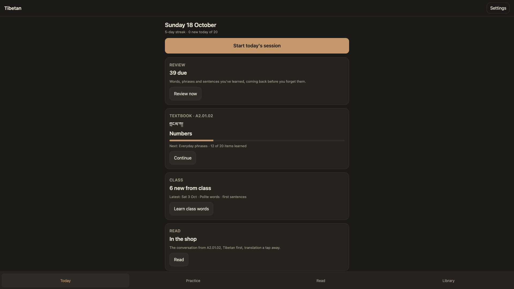
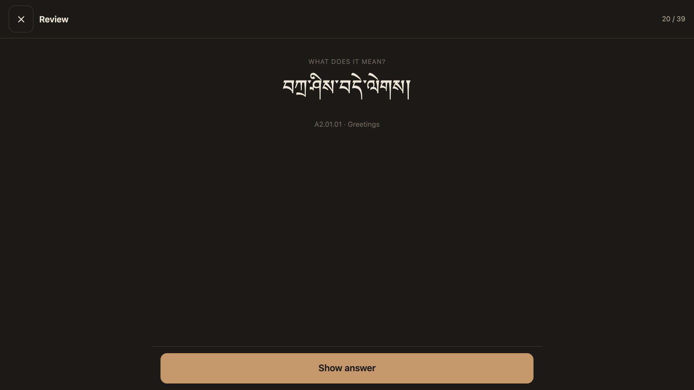
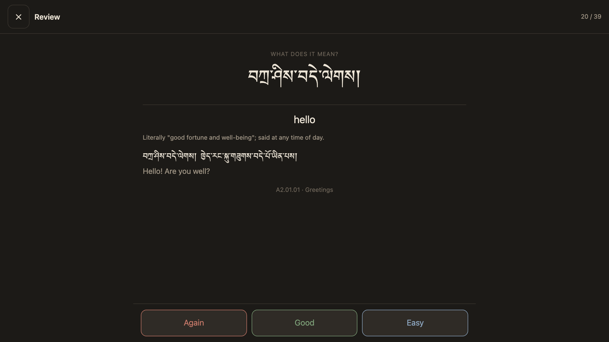
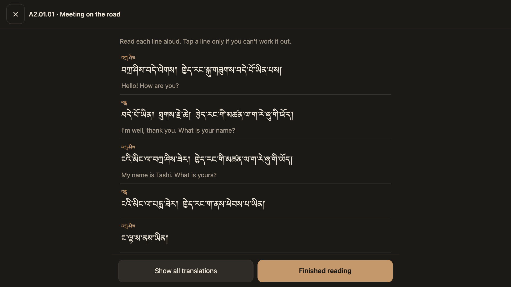
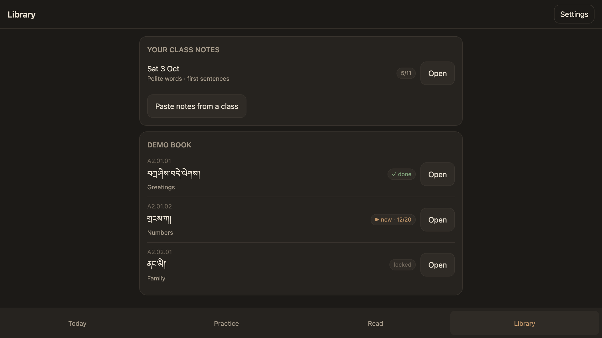

# tibetan-study

A self-hosted Tibetan study app with spaced repetition, and the pipeline that turns PDF textbooks into its lessons. The app is one HTML page served by a tiny local Python server (or shown on Android by a thin WebView shell), reading a plain folder of JSON: lessons, class notes, graded stories and per-device progress logs. The pipeline includes a repair step for Word-exported PDFs whose Tibetan text layer comes out garbled: it rebuilds each embedded font's character map from the font's own tables, so the text extracts correctly.



| Review card | Answer |
|---|---|
|  |  |

| Reading a lesson conversation | Library and progress |
|---|---|
|  |  |

The screenshots use the bundled demo lessons in `demo/`.

## Features
- **Today:** one button runs the day: reviews that are due (FSRS-4.5), then the next step of the current lesson (words → phrases → grammar → conversation, unlocking the next lesson when done), then new words from class notes, with a daily cap on new items.
- **Review cards** both ways for words and phrases, Tibetan-first for sentences and grammar; Again / Good / Easy, with keyboard shortcuts (space, 1, 2, 3).
- **Polite and ordinary pairs** (honorific vocabulary) as their own card type.
- **Read:** lesson conversations, class sentences and graded stories, Tibetan first, translation one tap away.
- **Practice** from any source, in either direction, with meanings in English or Chinese.
- **Library:** every lesson's words, phrases, grammar and conversation; "skip ahead" files earlier lessons' words as already known.
- **Class notes:** structured notes from a class (words, pairs, sentences, grammar) become cards; notes pasted in the app are saved to an inbox.
- **Sync without conflicts:** progress is an append-only event log per device (`progress/<device>.jsonl`), replayed on load, so several devices can share one synced folder. `tools/progress.py` prints the same state on the command line.
- **Offline, no accounts, no dependencies:** Python standard library on the desktop; one HTML file with no libraries; a Kotlin Android shell using platform APIs only.

## Try it with the demo data
Needs Python 3.9 or later and a browser.

```sh
git clone https://github.com/gregoryjayuk/tibetan-study
cd tibetan-study
TIBETAN_DATA=demo python3 tools/build_app.py      # compiles demo/ into demo/app/
python3 app/server.py --root demo                 # http://127.0.0.1:8742
```

Progress is written to `demo/progress/`. The server listens on localhost only; `--port` and `--device` change the port and the progress file's name.

## Your own data
Every tool reads one data folder, set with `TIBETAN_DATA` (the server also takes `--root`):

```
<data>/
  lessons/<level>/<id>.json   one file per lesson (format: demo/lessons)
  class/<date>.json           class notes: word, pair, sentence and grammar items (demo/class)
  readers/<level>.json        graded stories, one entry per sentence (demo/readers)
  app/                        written by tools/build_app.py: index.html and content.json
  progress/<device>.jsonl     written by the app, one file per device
  inbox/                      notes pasted in the app
```

`tools/build_app.py` treats levels A2 and B1 as the course, walked in order, and A1 as optional reading (`COURSE_LEVELS`, `EXTRA_LEVELS`).

## The textbook pipeline
Works with PDF textbooks you own; nothing from any book is included here. Needs poppler (`pdftotext`, `pdfinfo`).

```sh
python3 extract/run.py                         # repair "<level> book <n>.pdf" in the data folder, parse, write lessons/
python3 extract/readers.py                     # graded readers, one PDF per level
python3 tools/merge_translation.py X.en.json   # add an English layer (shape checked by extract/trans_schema_check.py)
python3 tools/merge_zh.py X.zh.json            # add Chinese glosses
python3 tools/merge_readers.py A2.en.json      # English for the stories
python3 tools/sheets.py                        # a readable Markdown sheet beside each lesson
python3 tools/build_app.py                     # compile everything for the app
```

- **PDF repair** (`extract/fixpdf.py`, `gsub.py`): the PDFs' ToUnicode maps split each shaped Tibetan cluster's characters unevenly across glyphs, so extracted text loses subjoined letters and gains stray vowels. Every embedded font still carries its cmap and GSUB tables, so the true string of each glyph is computed by walking ligature and single substitutions back to Unicode, and the PDF gets an incremental update with corrected maps. Handles Microsoft Himalaya (the full font is read from Word for Mac, or from `HIMALAYA_TTF`) and Monlam Uni OuChan2. No mapping tables are stored: they are derived from the fonts at run time.
- **Lesson parser** (`extract/parse_lessons.py`, `sections.py`, `tibnorm.py`): splits the text into lessons and sections (vocabulary with examples, everyday phrases, grammar, fill-the-gap sentences, conversation, proverb) and cleans up extraction artefacts. It is written for one series' layout of numbered sections with Tibetan headings, so other books will need `sections.py` adapted. Book-specific details (file names, misprinted labels) go in an optional `extract/book_config_local.py`; see `extract/book_config.py`.
- **Translations** are separate layers merged into the lesson JSON; the Tibetan is never modified, and re-running the extraction keeps the English wherever the structure still lines up.

## Android
`android/` is a WebView shell in Kotlin with no libraries (Activity, WebView, DocumentsContract). On first launch it asks for the data folder through the Storage Access Framework, loads `app/index.html` from it (falling back to a bundled copy) and gives the page a small bridge: read a file, list a folder, append to this device's progress log, save a pasted note. Because the page comes from the folder, keeping that folder synced (Syncthing or similar) brings each rebuild to the phone with no reinstall. Build with `android/build-apk.sh` (JDK 17 and the Android SDK, API 34; `TIBETAN_APK_DIR` sets where the APK is copied) or `cd android && ./gradlew assembleDebug`.

## Tech
Python 3 standard library (`http.server`, `json`, `zlib`, `struct`) · vanilla HTML, CSS and JavaScript in a single file · FSRS-4.5 scheduler implemented in both JavaScript and Python · Kotlin, Android API 26+ · poppler-utils for PDF text.

## Licence
MIT, see [LICENSE](LICENSE).
